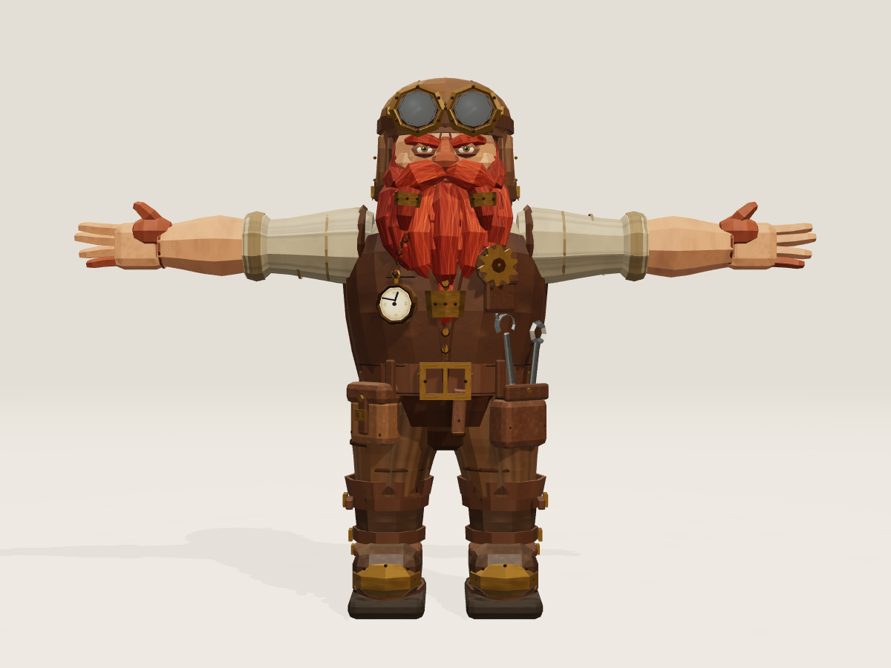

# Стимпанк-гном · Three.js → Blender

Полноценная низкополигональная 3D-модель стимпанк-гнома по референсу `img.png` и ТЗ `webchar.md`.
Модель процедурно собрана в Three.js, проверена в браузере, экспортирована в GLB и импортирована
в Blender штатным glTF-импортёром.



## Быстрый запуск

```bash
npm install
npm run dev
```

Откройте [http://127.0.0.1:5173/](http://127.0.0.1:5173/).

Управление:

- вращение — зажать левую кнопку мыши и тянуть;
- приближение — колесо мыши;
- `1` / `2` / `3` / `4` — спереди / сзади / слева / справа;
- `5` — три четверти, `0` — сброс камеры;
- `E` или кнопка **«Скачать GLB»** — экспорт `steampunk_dwarf.glb` из группы `dwarfRoot`.

В интерфейсе также есть кнопки **«3/4»**, **«Сброс»** и **«Скачать GLB»**. Камеры, источники
света, пол и элементы интерфейса находятся вне экспортируемой группы.

## Результаты

| Файл | Что внутри |
| --- | --- |
| `steampunk_dwarf.glb` | 18 610 треугольников, 1,81 × 0,45 × 1,30 м, 31 материал, 16 встроенных PNG-текстур |
| `steampunk_dwarf.blend` | Импортированная сцена Blender 5.2.2 LTS, все текстуры упакованы, 6 камер, студийный свет |
| `screenshots/browser/` | Скриншоты Three.js: спереди, сзади, слева, справа, 3/4 и интерфейс |
| `screenshots/blender/` | Рендеры Blender: спереди, сзади, слева, справа, 3/4 и крупный план лица |
| `src/` | Исходники процедурной модели, материалов, сцены, камеры и экспорта |
| `scripts/` | Playwright-скрипты проверки, скриншотов и экспорта |

## Модель

- Рост — **1,30 м**, подошвы стоят на уровне земли.
- Строгая **T-поза**: руки горизонтальны, локти выпрямлены, кисти продолжают линию предплечий,
  ладони раскрыты вперёд, по пять пальцев на каждой кисти.
- Размах рук — около **1,81 м**, глубина — **0,45 м**. Пропорции намеренно гномьи: крупные голова,
  борода, кисти и ботинки, короткие ноги.
- **18 610 треугольников** — в пределах ориентира 10–20 тысяч.
- Материалы — `MeshStandardMaterial`; все карты (кожа, ткань, кожа лица, волосы, латунь, сталь,
  стекло, циферблат) нарисованы процедурно на Canvas и встроены в GLB.
- Каждая деталь экспортируется: шляпа-авиатор с клапанами и ремнями, защитные очки с линзами и
  оправами, борода с боковыми и центральной косами в латунных обоймах, рубашка с подвёрнутыми
  рукавами, кожаный жилет, часы на цепочке, шестерёнка, широкий ремень с пряжкой, закрытый подсумок,
  открытый карман с двумя гаечными ключами, штаны с крупными складками и тяжёлые ботинки с
  латунными накладками, ремнями, пряжками и заклёпками.

## Проверка

### Браузер

- Сцена загружается без ошибок JavaScript (`pageerror`/console error — 0).
- Проверены все кнопки ракурсов: камера занимает позиции `front`, `back`, `left`, `right`, `3/4`.
- Проверены OrbitControls: вращение мышью и зум колесом меняют положение/дистанцию камеры.
- Кнопка экспорта скачивает `steampunk_dwarf.glb` размером **6 536 820 байт**; содержимое GLB
  совпадает с файлом в проекте.
- Экспортируется только группа `dwarfRoot`: камеры, свет и интерфейс в GLB не попадают.

### Blender

Импорт выполнен **штатным импортёром glTF** (`bpy.ops.import_scene.gltf`), без ручного поворота.

- Габариты после импорта: **1,8099 × 0,4468 × 1,3000 м**, минимальная координата Z = **0,0000** —
  персонаж стоит вертикально, подошвами на земле.
- 374 mesh-объекта, 31 материал `dwarf_*`, 16 упакованных изображений; ни одна текстура не потеряна.
- 46 empty-объектов сохраняют иерархию (корень `dwarfRoot`, группы `head`, `torso`, `arms`, `legs`,
  `accessories`, `beard`, `hat`, `goggles`, `belt`, `tool_pouch` и т. д.).
- Объекты разложены по коллекциям `SteampunkDwarf` → `01_Legs_and_Boots`, `02_Torso_and_Vest`,
  `03_Arms_and_Hands`, `04_Head_Hat_Beard`, `05_Accessories`; камеры/свет/пол — в `Studio`.
- В сцене сохранены 4 ортографические камеры, камера 3/4, камера для крупного плана, студийный
  свет и настройки EEVEE (AgX, средний контраст). Рендеры лежат в `screenshots/blender/`.

### Примечания

- Боковые скриншоты — честный вид сбоку: в T-позе ближняя рука направлена в камеру и выглядит
  сильно ракурсно; это корректно для заданной позы. Объём и профиль корпуса хорошо видны на
  виде 3/4.
- Blender использует AgX и студийные источники света, поэтому оттенки и блики немного отличаются
  от браузерного ACES-рендера; геометрия, материалы и текстуры при переносе сохранены.

## Структура проекта

```
web/
├── index.html
├── src/
│   ├── main.js              # точка входа: сцена + персонаж + интерфейс
│   ├── scene.js             # рендерер, свет, пол, OrbitControls
│   ├── viewer.js            # кнопки ракурсов, анимация камеры, экспорт
│   ├── export.js            # GLTFExporter и скачивание
│   └── character/
│       ├── index.js         # createDwarf(), нормализация роста, flat-нормали
│       ├── geometry.js      # loft, пряди, оболочки, пряжки, шестерёнки, ключи
│       ├── textures.js      # процедурные CanvasTexture
│       ├── materials.js     # MeshStandardMaterial
│       ├── head.js          # лицо, борода, шляпа, очки
│       ├── torso.js         # рубашка, жилет, воротник, карманы
│       ├── arms.js          # рукава, предплечья, кисти, пальцы
│       ├── legs.js          # штаны, ботинки, ремни, подошвы
│       └── accessories.js   # ремень, подсумки, ключи, часы, шестерёнка
├── scripts/
│   ├── shoot.mjs            # скриншоты через Playwright
│   ├── verify.mjs           # проверка кнопок, OrbitControls и экспорта
│   └── export.mjs           # экспорт GLB и проверка кнопки скачивания
├── screenshots/
│   ├── browser/
│   └── blender/
├── steampunk_dwarf.glb
├── steampunk_dwarf.blend
├── img.png                  # референс
└── webchar.md               # ТЗ
```

## Команды разработки

```bash
npm run dev       # Vite dev server
npm run build     # production-сборка
node scripts/shoot.mjs    # обновить браузерные скриншоты
node scripts/verify.mjs   # проверить кнопки, вращение, зум и скачивание
node scripts/export.mjs   # пересобрать GLB и проверить download
```

Браузерные скриншоты снимаются в разрешении 1200×900, рендеры Blender — 1200×900 (лицо — 900×900).
